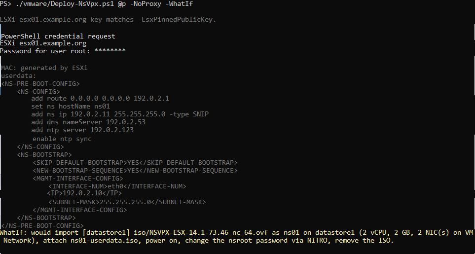
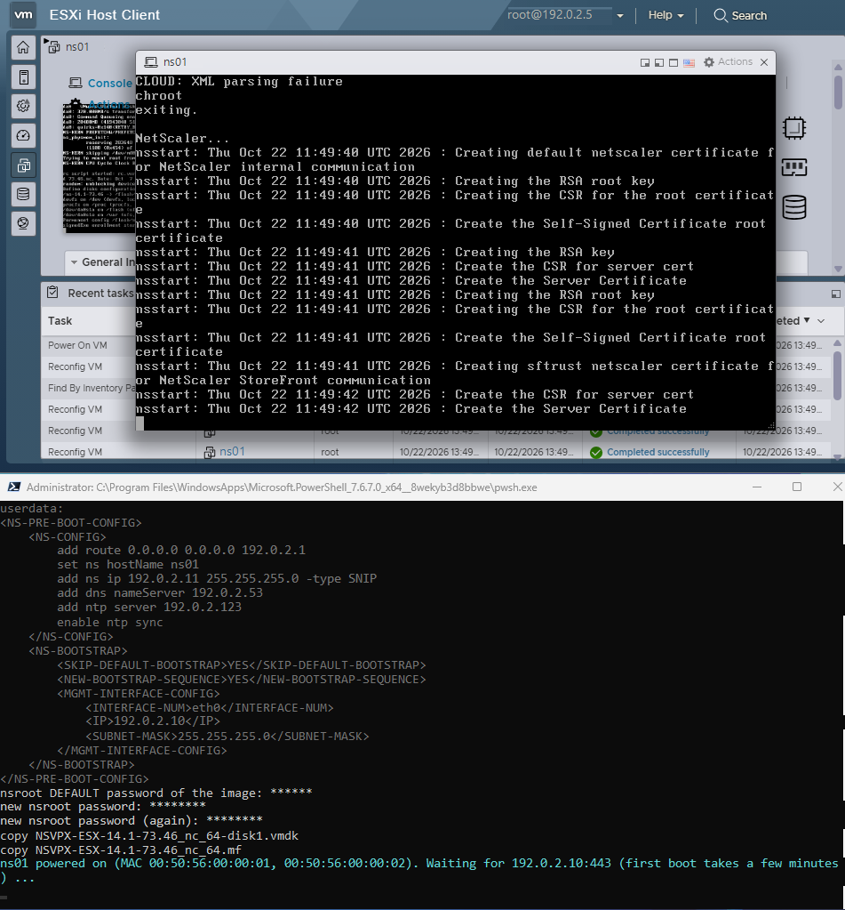
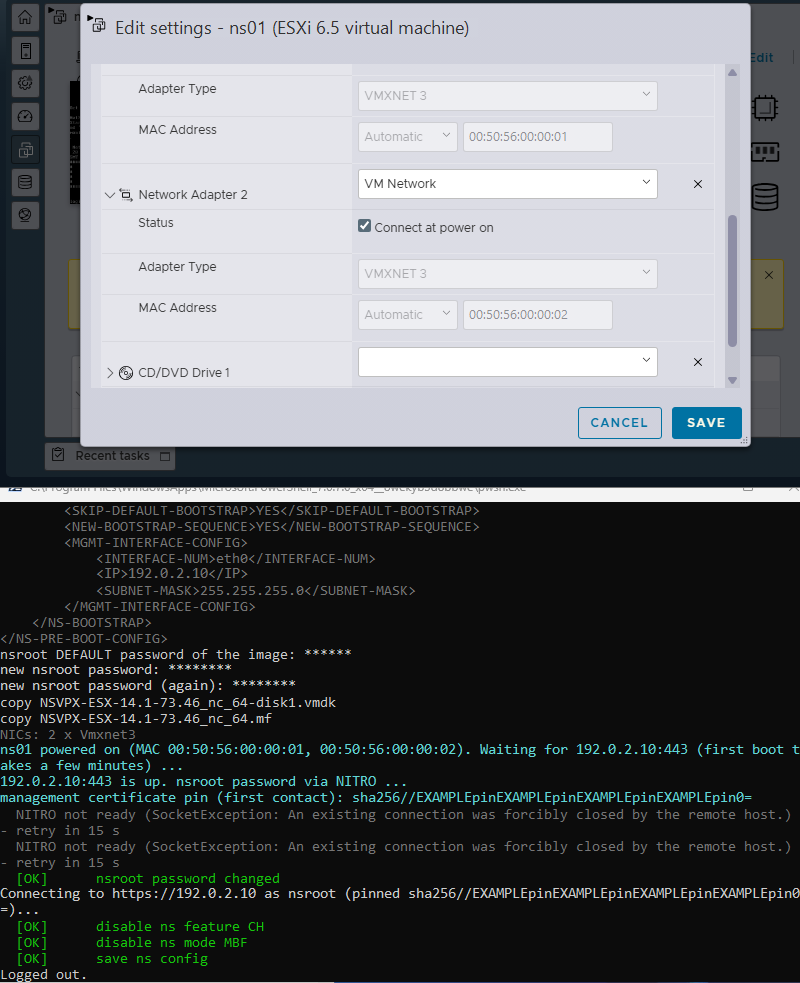
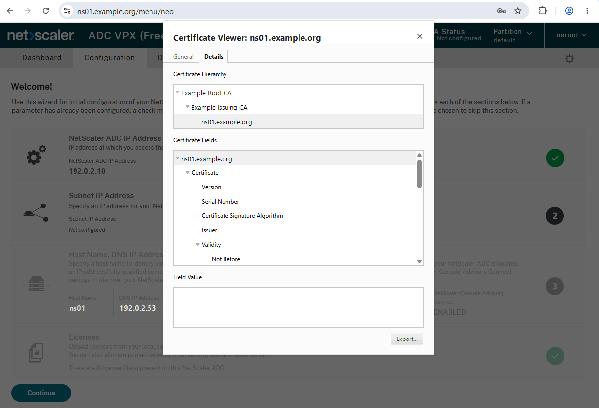

# Deploying a VPX on ESXi

`vmware/Deploy-NsVpx.ps1` puts a new NetScaler VPX on a **standalone ESXi host** (no vCenter, no console session):
OVF import, network settings at first boot, forced nsroot password change. After that the VPX is ready for its
configuration (CLI, GUI or NITRO tooling). The script is standalone: no other file of this repo is needed.

## Requirements

- Windows with PowerShell 7.2+ (the userdata ISO is built with the Windows IMAPI2 API; `-InitNsroot` alone also runs
  on Linux/macOS).
- VMware PowerCLI, once per user: `Install-Module VCF.PowerCLI -Scope CurrentUser` (older name: `VMware.PowerCLI`).
- The VPX OVF package for ESX (`NSVPX-ESX-<build>_nc_64.ovf` + `.mf` + disk) unpacked on a datastore of the host.
- HTTPS/443 from this machine to the new NSIP, and the ESXi host's HTTPS API.
- An ESXi account that may create VMs (prompted; root on a lab host).

## What it does

1. Copies the OVF package from the datastore to a temp folder and imports it (`Import-VApp`, thin disks);
   sets vCPU, memory, NIC count, port group and optional static MAC addresses.
2. Builds a **preboot userdata ISO** (NetScaler: "Apply NetScaler VPX configurations at the first boot of the
   NetScaler appliance on VMware ESX") with NSIP + mask, default route, host name, optional SNIP, DNS and NTP
   servers and the lines of `-ExtraConfig`, copies it into the VM folder and attaches it as CD drive. The ISO holds
   **no secrets**: `-ExtraConfig` lines containing `password` are refused.
3. Powers the VM on and waits up to 15 minutes for 443 on the NSIP.
4. Reads the new VPX's self-signed management certificate key and **pins it on first contact** (printed as
   `sha256//...`), logs in with the image's default nsroot password and a new one (the forced first-login
   change), optionally sets the RPC node password, disables `-DisableFeature` (default `CH`) and `-DisableMode`
   (default `MBF`) and saves the config.
5. Removes the userdata ISO (eject, delete from the datastore) once step 4 has succeeded: the NITRO login proves the
   first boot applied it. The ISO is **kept** for diagnosis if anything fails (443 timeout, NITRO error), with
   `-SkipNsroot` (first boot not confirmed) and with `-KeepIso`; the run then prints the `-Cleanup` command.

All passwords are prompted masked at the start (ESXi login, image default nsroot password, new nsroot password
twice, RPC password with `-SetRpcPassword`), so the run is unattended afterwards. They stay in memory; nothing goes
into the ISO, a file or a command line.

## Usage

```powershell
# where is the OVF?
./vmware/Deploy-NsVpx.ps1 -EsxHost esx01.example.org -ListOvf

# dry run: checks and the userdata, no prompts except the ESXi login, no changes
./vmware/Deploy-NsVpx.ps1 -EsxHost esx01.example.org -OvfPath '[datastore1] iso/NSVPX-ESX-14.1-xx.xx_nc_64.ovf' `
    -VmName ns01 -Datastore datastore1 -Nsip 192.0.2.10 -Gateway 192.0.2.1 -Snip 192.0.2.11 `
    -DnsServer 192.0.2.53 -NtpServer 192.0.2.123 -EsxPinnedPublicKey 'sha256//...' -NoProxy -WhatIf

# deploy (same line without -WhatIf); removes the userdata ISO at the end

# only after a failed run, -SkipNsroot or -KeepIso: eject + delete the userdata ISO (VM may keep running)
./vmware/Deploy-NsVpx.ps1 -EsxHost esx01.example.org -VmName ns01 -Datastore datastore1 -Cleanup
```

The deploy prints the management key pin (`sha256//...`, same format as `curl --pinnedpubkey`); NITRO tools that
support key pinning can use it until the management certificate is replaced.

## Screenshots

Lab run on 14.1 build 73.46 (names, addresses, MACs and pins replaced with placeholders).

**Dry run** (`-WhatIf`): ESXi key check, the userdata that goes into the ISO, what the real run would do.



**First boot**: the VPX boots with the userdata ISO (ESXi Host Client console) while the script waits for 443.



**NICs and NITRO**: two VMXNET3 adapters (`-NicCount 2 -NicType Vmxnet3`), then the key pinned on first contact, the
forced nsroot change (the first NITRO contact is retried while NITRO starts), CallHome / MBF off and the save.



**Afterwards** (optional next step): the management certificate replaced with a CA-signed one (see Next steps). The
VPX was deployed without a SNIP, as an HA secondary-to-be: the setup wizard shows "Subnet IP Address - Not
configured".



## Next steps

1. Fresh 14.1 VPX: enable the default SSL profile before creating SSL vservers
   (`set ssl parameter -defaultProfile ENABLED`, cannot be undone) - otherwise new vservers allow SSLv3/TLS 1.0/1.1.
2. Management access only over HTTPS: `set ns ip <NSIP> -gui SECUREONLY -telnet DISABLED -ftp DISABLED`.
3. Management certificate: replace the self-signed one with a CA-signed certificate that renews itself, e.g. with
   [netscaler-acme](https://github.com/bensplittgerber/netscaler-acme) (ACME, binds it to the management services).
   Afterwards trust the CA instead of the pin.

## Parameters

| Parameter | Default | Meaning |
|---|---|---|
| `-EsxHost` | - | ESXi host name or IP |
| `-EsxPinnedPublicKey` | none (warning) | `sha256//...` of the ESXi host key; a mismatch stops the run (see Notes) |
| `-OvfPath` | - | `'[datastore] folder/file.ovf'` as printed by `-ListOvf` |
| `-VmName` | - | VM name; also the NetScaler host name unless `-HostName` is set |
| `-Datastore` | - | datastore for the VM and the userdata ISO |
| `-Network` | `VM Network` | port group for all NICs |
| `-Nsip`, `-Netmask`, `-Gateway` | -, `255.255.255.0`, - | management address and default route |
| `-Snip` | none | SNIP at first boot; leave empty for an HA secondary (the primary's SNIP floats over) |
| `-DnsServer`, `-NtpServer` | none | one or more; NTP also enables `ntp sync` |
| `-ExtraConfig` | none | `.cli` file(s) with more first-boot lines (`enable ns feature ...`, modes); `#` = comment |
| `-ExpectBuild` | none | warn if the OVF name does not contain this build (HA needs the same build on both nodes) |
| `-NumCpu`, `-MemoryGB`, `-NicCount` | 2, 2, 1 | VM size; NICs 0/1, 1/1, 1/2, ... all on `-Network` |
| `-NicType` | as in the OVF (E1000) | `Vmxnet3` or `E1000` for all NICs (VMXNET3: paravirtual, less host CPU) |
| `-MacAddress` | ESXi generated | one MAC per NIC, e.g. to keep the MAC of a rebuilt VM (DHCP, firewall, NAT entries) |
| `-BiosUuid` | ESXi generated | SMBIOS UUID of the VM (`uuid.bios`), e.g. kept from the old VM (`-ShowIdentity`); `.vmx` notation, `8-4-4-4-12` or 32 hex digits |
| `-SkipNsroot` | off | no password change; do it at the first login or later with `-InitNsroot` (ISO is kept) |
| `-KeepIso` | off | keep the userdata ISO after a successful run (remove it later with `-Cleanup`) |
| `-SetRpcPassword` | off | also prompt for an RPC node password (must be the same on both HA nodes) |
| `-DisableFeature`, `-DisableMode` | `CH`, `MBF` | switched off after boot; `@()` leaves them as they are |
| `-NoProxy` | off | NITRO calls bypass the system proxy |
| `-WhatIf` | off | dry run: checks + userdata only |

Other modes: `-ListOvf` (OVFs on all datastores), `-Cleanup` (userdata ISO off the VM and the datastore, for the
cases where the deploy kept it),
`-InitNsroot -Nsip ...` (only step 4 against a running VPX, asks for the current and an optional new password),
`-ShowIdentity -VmName ...` (MACs and BIOS UUID of an existing VM, see "Rebuild with the same identity"),
`-LasRequest` / `-LasActivate` (offline LAS activation, see below).

| Parameter (LAS modes) | Default | Meaning |
|---|---|---|
| `-Nsip` | - | the running VPX |
| `-NsPinnedPublicKey` | first contact (warning) | `sha256//...` of the VPX management certificate key, as printed by the deploy |
| `-UseHostname` | off | `-LasRequest`: name the VPX by its host name in Citrix Cloud (GUI toggle "Use hostname") |
| `-OutDir` | `.` | `-LasRequest`: where the request `.tgz` goes |
| `-ActivationFile` | - | `-LasActivate`: the activation file from Citrix Cloud |
| `-Reboot` | off | `-LasActivate`: save the config, warm reboot, show the licensing mode afterwards |
| `-NoProxy`, `-WhatIf` | off | as above |

## Offline LAS activation (Fixed Capacity / Fixed Bandwidth subscription)

For a VPX without internet access to the License Activation Service. Same flow as the GUI (License > ADC License >
LAS Activation), over NITRO; the nsroot password is prompted masked.

```powershell
# 1. request: show ns licenseactivationdata + download from /nsconfig/license
./vmware/Deploy-NsVpx.ps1 -LasRequest -Nsip 192.0.2.10 -NsPinnedPublicKey 'sha256//...' -NoProxy

# 2. Citrix Cloud > Licensing > NetScaler licenses > NetScaler ADC: upload the request, download the activation file

# 3. activation: add system file + apply ns laslicense -fixedBandwidth, save, warm reboot, show the result
./vmware/Deploy-NsVpx.ps1 -LasActivate -Nsip 192.0.2.10 -NsPinnedPublicKey 'sha256//...' `
    -ActivationFile ./NS_<id>_activation.blob.tgz -Reboot -NoProxy
```

What to know (14.1 build 73.46 and 73.49):
- The **request** (`<id>_activation_request.tgz`, or `<host name>_...` with `-UseHostname`) holds JSON with the
  identifier, the build, a request time and the public key of a **key pair the VPX creates on the first request**
  (`/nsconfig/license/las_key_pair/`, kept for later requests). The identifier is the SHA-256 of the Host Id (`show
  ns hardware`, the MAC of interface 0/1) - also with `-UseHostname`, which only changes the name. No secrets in it.
  The GUI shows an expiry of 7 days for the request.
- The **activation file** is signed (JWT, RS256, chain up to "Citrix LAS Root CA V1"), not encrypted. It names the
  identifier, the products and the validity, and carries the request's public key, signed by Citrix.
- It only applies on the VPX that holds the request's key pair. Elsewhere: `License blob is invalid: blob not
  applicable for this LPEID`. The VPX also checks the key pair against a secret tied to the VM (`HMAC mismatch -
  pubkey may be tampered` in `/var/log/ns.log`, then a new key pair) - copying `las_key_pair` to another VM does not
  work.
- `apply ns laslicense` without `-fixedBandwidth` fails with `Failed to parse las license file`.
- `show ns laslicense` is ACTIVE right after the import; the licensing mode (`show ns license`) switches to
  "LAS (Fixed Bandwidth)" after a reboot.
- On a licensed VPX a new request also carries the last activation id (renewal / rehost in Citrix Cloud).

## Rebuild with the same identity (keeps an offline LAS license)

A rebuilt VPX keeps an offline LAS activation only if the new VM looks like the old one and gets its files back.
Validated on a standalone host:

| Same MAC on 0/1 | Same BIOS UUID | Restored | Result |
|---|---|---|---|
| yes | no | `las_key_pair` only | key pair rejected (HMAC mismatch), activation not applicable |
| yes | no | full system backup | key pair rejected at boot |
| yes | yes | full system backup | activation applies, LAS (Fixed Bandwidth) after the reboot |

1. Before removing the old VM: read its identity, and take a **full** system backup after the activation (`create
   system backup <name> -level full`, then copy it off the VPX - it contains private keys, treat it like a PFX).
   ```powershell
   ./vmware/Deploy-NsVpx.ps1 -EsxHost esx01.example.org -VmName ns01 -ShowIdentity
   ```
2. Remove the old VM, deploy the new one with the printed `-MacAddress` / `-BiosUuid` (and the same `-NicCount`).
   A new VM with the same name in the same folder usually gets the same BIOS UUID anyway; `-BiosUuid` makes it
   explicit.
3. Copy the backup to `/var/ns_sys_backup/`, `add system backup <file>`, `restore system backup <file>`, then a
   **warm reboot from the CLI**. Do not power the VM off right after the restore: in the lab that left the VPX
   unconfigured (factory IP) at the next boot.
4. Apply the activation file again (`-LasActivate -Reboot`) unless the restored backup already contains it, and check
   `show ns laslicense` / `show ns license`.

Two VMs with the same MAC or BIOS UUID must never run at the same time; the deploy refuses a MAC or BIOS UUID that
another registered VM still has.

## Notes

- **Pin on first contact**: the key is read from the network without any trust anchor. That is acceptable for a
  freshly deployed VM on a management LAN; compare it with the VM console (`show ssl certKey ns-server-certificate`)
  if the path is not trusted. Replace the management certificate later (see Next steps).
- `disable ns feature` / `disable ns mode` lines in the userdata do not stick on 14.1 (CH and MBF are on again
  after the first boot); `enable` lines work. That is why step 4 disables them via NITRO.
- An existing VM with the same name stops the run. For a rebuild power off and remove the old VM first; pass its
  MAC with `-MacAddress` if something depends on it. MACs outside the VMware manual range (`00:50:56:00-3f:..`)
  are written into the `.vmx` directly (`checkMACAddress = FALSE`) and the VM is re-registered.
- **ESXi host certificate**: PowerCLI cannot pin keys, so it runs with `InvalidCertificateAction Ignore` (current
  session only). Pass `-EsxPinnedPublicKey` and the script compares the host key on its own TLS handshake right
  before `Connect-VIServer`; a mismatch stops the run, without it you get a warning. Read the value on the host
  (ESXi shell/SSH), not over the network you want to check:
  ```sh
  openssl x509 -in /etc/vmware/ssl/rui.crt -noout -pubkey | openssl pkey -pubin -outform der |
    openssl dgst -sha256 -binary | openssl base64      # prefix the output with sha256//
  ```
  The value changes when the host certificate is renewed.
- The ESXi banner "configured guest OS (FreeBSD (64-bit)) ... does not match ... FreeBSD 11 (64-bit)" is cosmetic:
  the OVF's hardware version (ESXi 6.5, vmx-13) has no FreeBSD 11 entry, so the script leaves the guest OS as is.
- IDE CD drives cannot be removed from a running VM, so the ISO is ejected and the empty drive stays. If ESXi asks
  to override the guest's tray lock, the script answers Yes. If the automatic removal fails, the VPX is still ready:
  the run warns and prints the `-Cleanup` command.
- Snapshots: take them after the ISO is gone, otherwise a revert asks for the deleted ISO.
